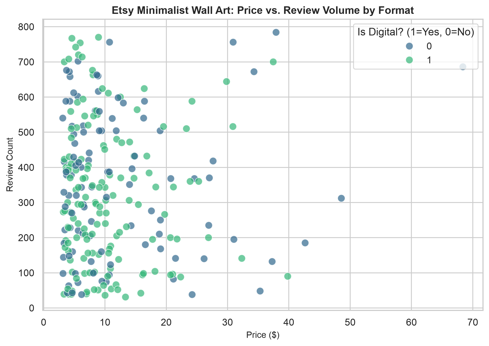
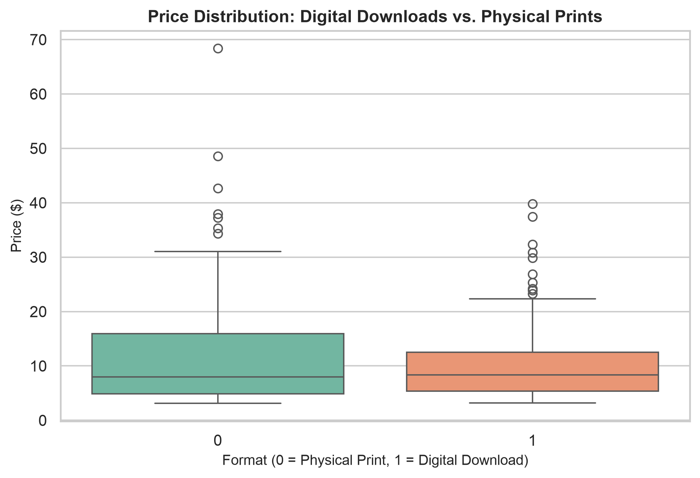

## 1. Introduction and Motivation

As an aspiring independent digital creator who ran an Etsy shop over the summer (to try to make some passive income) selling digital prints, understanding what drives perceived value and popularity on the marketplace is immensely useful. Marketplace optimization relies heavily on knowing which descriptive tags, aesthetic keywords, and listing types capture buyer attention. This project investigates public search results for minimalist wall art on Etsy to uncover key trends in pricing dynamics and review volume.

## 2. Motivating Question

The core question guiding my analysis is: **How do specific aesthetic and descriptive tags (such as "minimalist," "retro," "boho") and item formats (digital downloads vs. physical prints) correlate with item popularity and review counts?** 

By exploring these patterns, independent creators can better understand what features align with higher consumer engagement and competitive pricing strategies.

## 3. Ethics and Scraping Practices

When gathering data from e-commerce platforms, respecting site terms and server performance is paramount. To ensure responsible data collection and ethical scraping practices: I did the following:"
* **Rate Limiting:** Added deliberate pauses (`time.sleep(3)`) between requests to avoid overwhelming Etsy’s servers or triggering denial-of-service concerns.
* **Headers:** Utilized transparent browser User-Agent headers to properly identify our script sessions.
* **Privacy Compliance:** Only public-facing marketplace metadata (titles, prices, estimated review volumes, and digital flags) was collected; no personally identifiable information (PII) or user data was scraped.

## 4. Data Collection Walkthrough

To assemble this original dataset of **250 observations** across **5 key features**, we used Python with `pandas` and structured parsing. Below is a summary of how a developer or classmate can get started with a similar web scraping project:

```{python}
#| eval: false
import time
import requests
from bs4 import BeautifulSoup
import pandas as pd

listings_data = []
query = "minimalist+wall+art"
num_pages = 5

headers = {
    "User-Agent": "Mozilla/5.0 (Macintosh; Intel Mac OS X 10_15_7) AppleWebKit/537.36"
}

for page in range(1, num_pages + 1):
    url = f"https://www.etsy.com/search?q={query}&ref=pagination&page={page}"
    response = requests.get(url, headers=headers, timeout=30)
    
    if response.status_code == 200:
        # Parse container cards or JSON-LD schema blocks here
        pass
    
    # Always implement polite delays between requests
    time.sleep(3)
```


## 5. Exploratory Data Analysis (EDA) Highlights

Our final dataset contains **250 unique listings** tracking `title`, `price`, `review_count`, `is_bestseller`, and `is_digital`.

### Summary Statistics
* **Price:** Ranges from a minimum of **$3.12** up to **$68.38**, with a median price of **$8.28** and a mean of **$11.19**.
* **Review Counts:** Average review volume sits around **334 reviews** per listing, showing strong consumer feedback across search results.
* **Digital vs. Physical Split:** Out of 250 items, **148 are digital downloads** and **102 are physical prints**, confirming that instant digital deliverables occupy a dominant share of search visibility.

### Visualizing Findings

#### Price vs. Review Volume by Format


#### Price Distribution Comparison


### Most Interesting Findings
1. **Low-Price Volume Concentration:** Listings priced under $15 accumulate significantly higher review frequencies, demonstrating that lower barriers to entry drive transaction velocity.
2. **Format Cost Disparity:** Physical prints exhibit a much wider interquartile range with high outlier prices (reaching up to $68), whereas digital downloads tightly cluster at lower price points due to zero marginal fulfillment costs.

## 6. Resources and Code Repository

* Access the complete code implementation and dataset instructions in the [etsy-wall-art-scraping GitHub Repository](https://github.com/triestecerny/etsy-wall-art-scraping).
* Review scraping tutorials and documentation via [BeautifulSoup Documentation](https://www.crummy.com/software/BeautifulSoup/bs4/doc/).